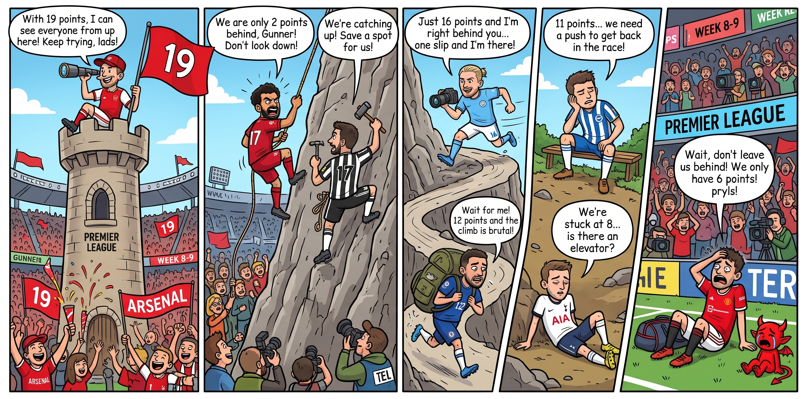

<div align="center">

# Matchline

### Your Team. Your Story. Your Voice.

**An interactive football-media prototype built for the fan journey—not the scoreboard alone.**

`React 19` · `TypeScript` · `Vite` · `Zustand` · `Leaflet`

[Run locally](#run-locally) · [Explore routes](#key-routes) · [Contribute](#contributing)

</div>

---



## ✨ What you can explore

| 🗺️ Follow the story | 💬 Join the conversation | 🏆 Feel the stakes |
| --- | --- | --- |
| A personalized, Candy Crush-inspired Match Journey and stadium map. | Match-grounded AI demo and local fan discussions. | Fictional standings, deterministic predictions and a local leaderboard. |

## ⚡ Quick start

1. Install Node.js 22 LTS or newer.
2. Clone the repository (or open an existing checkout).
3. Follow the commands for your operating system in [Run locally](#run-locally).

When Vite starts, open [http://localhost:5173](http://localhost:5173). You can also jump straight to [the standings](http://localhost:5173/standings).

## 🧰 Prerequisites

- [Node.js 22 LTS or newer](https://nodejs.org/) (includes npm)
- Git
- An internet connection for the first dependency install and map tiles

Check that Node.js, npm, and Git are available:

```text
node -v
npm -v
git --version
```

On Windows, use the Node.js installer and keep **Add to PATH** enabled. On macOS and Linux, the Node.js installer from [nodejs.org](https://nodejs.org/) works on supported systems; a version manager is also fine. Restart your terminal after installation if `node` or `npm` is not found.

## 🚀 Run locally

If you have not cloned the project yet, run the clone command for your platform first. If you already have it, start with `cd`.

### Windows — PowerShell

```powershell
git clone https://github.com/Aliz-f/matchline-mvp.git
cd .\matchline-mvp
npm ci
Copy-Item .env.example .env.local
npm run dev
```

Open the URL Vite prints in the terminal, usually [http://localhost:5173](http://localhost:5173). To view the standings page directly, open [http://localhost:5173/standings](http://localhost:5173/standings).

### Windows — Command Prompt

```bat
git clone https://github.com/Aliz-f/matchline-mvp.git
cd matchline-mvp
npm ci
copy .env.example .env.local
npm run dev
```

### macOS

```bash
git clone https://github.com/Aliz-f/matchline-mvp.git
cd matchline-mvp
npm ci
cp .env.example .env.local
npm run dev
```

### Linux

```bash
git clone https://github.com/Aliz-f/matchline-mvp.git
cd matchline-mvp
npm ci
cp .env.example .env.local
npm run dev
```

`npm ci` uses the committed lockfile for a reproducible install. If you intentionally change dependencies, run `npm install` instead to update `package-lock.json`.

## 🧪 Available commands

| Command | Purpose |
| --- | --- |
| `npm run dev` | Start the Vite development server. |
| `npm run typecheck` | Check TypeScript types without creating a build. |
| `npm run test` | Run the Vitest test suite once. |
| `npm run build` | Create a production build in `dist/`. |
| `npm run check` | Run typecheck, tests and production build together. |
| `npm run preview` | Serve the latest production build locally. |

Before opening a pull request, run the same command on every platform:

```bash
npm run check
```

## 🤖 Optional AI demo

The safe default is offline mock mode. It needs no key or network request:

```dotenv
# .env.local
VITE_AI_MODE=mock
VITE_OPENROUTER_API_KEY=
VITE_OPENROUTER_MODEL=openai/gpt-4o-mini
```

To try direct OpenRouter calls locally, use a temporary, low-limit key only:

```dotenv
VITE_AI_MODE=live
VITE_OPENROUTER_API_KEY=your-temporary-key
VITE_OPENROUTER_MODEL=openai/gpt-4o-mini
```

Restart `npm run dev` after editing `.env.local`. Any value prefixed with `VITE_` is exposed to the browser, so never commit, deploy publicly or reuse a working API key. Switch back to `mock` after a controlled demo.

## 🧭 Key routes

| Route | What it shows |
| --- | --- |
| `/` | Personalized Match Journey |
| `/matches` | Filterable fixture list |
| `/matches/:id` | Match details, events, stats and AI conversation |
| `/stadiums` | Stadium map with simulated fixture activity |
| `/predictions` | Local score predictions and leaderboard |
| `/community` | Local match discussions |
| `/standings` | Fictional partial league table and comic |
| `/preferences` | Favorite club and story preferences |
| `/premium` | Simulated premium capability preview |

## 🎯 Project boundaries

- No backend, authentication, payments or real sports-data API is included.
- User preferences, predictions and community interactions are stored only in browser `localStorage`.
- Prediction scoring is deterministic: **5** points for an exact result, **3** for a correct outcome and **0** otherwise.
- The stadium map uses approximate real-world locations; its match activity remains fictional.

## 📦 Deployment notes

Build the static site with:

```bash
npm run build
```

Deploy the generated `dist/` directory to a static host. The app uses `BrowserRouter`, so configure an SPA fallback that serves `index.html` for unknown paths. Netlify can use the included `public/_redirects` file.

## 🛟 Troubleshooting

| Problem | What to do |
| --- | --- |
| `node` or `npm` is not recognized | Install Node.js LTS, ensure it is added to PATH, then reopen the terminal. |
| `npm install` fails | Confirm the internet connection and retry; corporate proxy settings may need configuration. |
| Port 5173 is busy | Vite will offer another port; open the replacement URL printed in the terminal. |
| AI call fails | Use `VITE_AI_MODE=mock`; browser-origin and CORS restrictions can block direct OpenRouter requests. |
| Map tiles do not load | The rest of the app remains usable; tiles require network access. |

## 🤝 Contributing

Read [AGENTS.md](AGENTS.md) and the documents in [`docs/`](docs/) before changing code. In particular, preserve the canonical mock data in `src/data/`, do not introduce real match claims, and do not commit `.env.local` or API credentials.

For the full test and route checklist, see [docs/06-INTEGRATION-QA.md](docs/06-INTEGRATION-QA.md).
