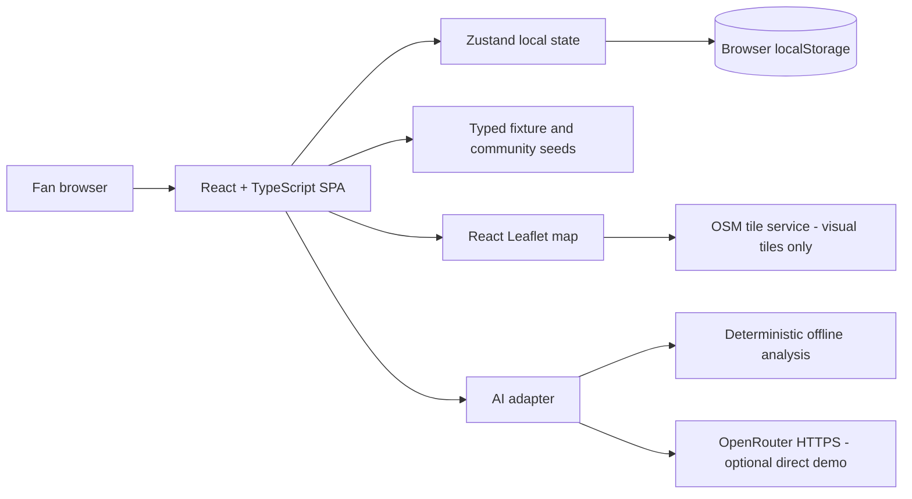
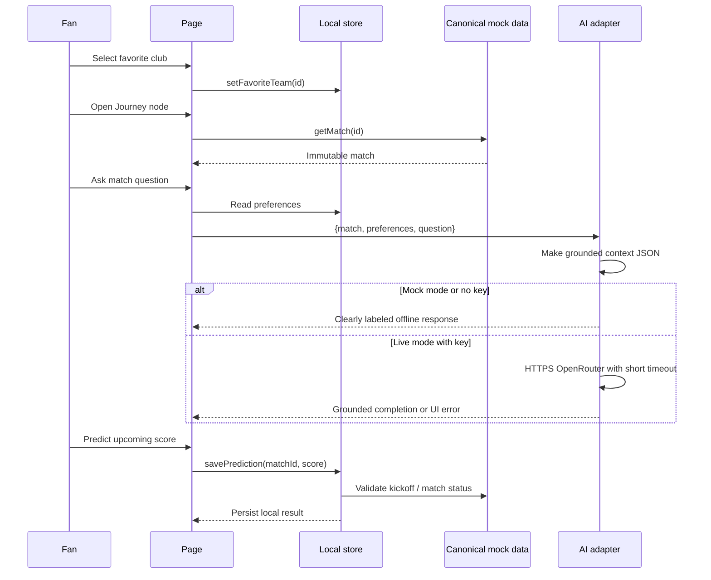

# 02 — Frontend architecture and module boundaries

## 1. System context

No backend, websocket, database or actual third-party football feed. `src/services/ai.ts` is the only football-AI transport boundary. `src/data/*.ts` supply canonical facts; `src/store/useAppStore.ts` contains mutating simulated user behavior.

## 2. Project module directory responsibilities

| Directory | Owns | Must not own |
|---|---|---|
| `src/app` | React Router and nav/shell | Match-specific business logic |
| `src/styles` | Shared tokens and global responsive visual system | Sports facts or AI prompts |
| `src/components` | Reusable primitives, small composables | Mutating prediction/community data |
| `src/data` | Immutable football fixtures, teams, competition names, sample community seeds | React state or network calls |
| `src/types` | Canonical TS unions/interfaces | Runtime lookup functions |
| `src/config` | Frozen demo clock, mode toggles | Production credentials |
| `src/lib` | Pure outcome/scoring/format/selectors | Fetch and React components |
| `src/services` | AI request transport/prompt context | Favorite-team setting |
| `src/store` | Local user preferences, prediction saves, community simulation | Sports fixture mutation |
| `src/features/*` | Page composition, UI interactions | Duplicated domain types |

## 3. Route contract

| Path | Page component | Detail |
|---|---|---|
| `/` | `JourneyPage` | Selected-team match roadmap and featured game |
| `/matches` | `MatchesPage` | All seeded fixtures filterable by status |
| `/matches/:id` | `MatchDetailsPage` | `id` must resolve through `getMatch`; show missing-state fallback otherwise |
| `/stadiums` | `StadiumPage` | UK map of club stadiums and activity |
| `/predictions` | `PredictionsPage` | Only open/upcoming fixtures |
| `/community?match=m03` | `CommunityPage` | Filter thread using canonical match ID query |
| `/standings` | `StandingsPage` | Static partial standings |
| `/preferences` | `PreferencesPage` | localStorage-backed controls |
| `/premium` | `PremiumPage` | Simulated entitlement toggle |

## 4. State model

**Canonical football data are read-only:** arrays exported by `src/data/teams.ts`, `matches.ts` and `community.ts`. Individual screens must not store private copies or update those records when a user predicts.

**Session-like state** persists to localStorage under `matchline-demo-v1`: user favorite team, tone, interests, local consent preference, simulated free/premium mode, saved predictions, locally added/reported/liked posts, onboarding flag. User IDs are fictional (`you`, `fan-ada` etc.).

**Temporary UI state** lives in React local hooks: chat messages, current input, selected match status filter, map pin filters, temporary success messages. Not all temporary UI must survive reload.

**Invariants:**
- A prediction `matchId` always references a known `upcoming` match whose kickoff is after `DEMO_NOW`.
- Valid exact-score integers 0..15 are checked *inside* the store, not only HTML form constraints.
- Match kickoff timestamps have explicit timezone offsets (DST-safe); display uses `Europe/London`.
- `predictionPoints` is a pure function. No AI model chooses winners, scores or points.
- AI context is derived at call time from canonical match + preferences and cannot take event history from user prose.

## 5. User journey and AI dataflow

## 6. OpenRouter contract

`askMatchlineAI({match, preferences, question, signal?}) -> Promise<{content, source}>` supports mock/local and OpenRouter/direct-browser modes. Request implementation: POST `/api/v1/chat/completions`, `Authorization: Bearer ...`, `{ model, max_tokens, temperature, messages }` and optional identifying headers.

- **Grounding:** system instructions require facts only from the serialized fixture/standing snapshot and labeling of counterfactuals.
- **Fan privacy:** send no email/password; only fictional match data and user-selected preferences. Do not send saved community posts or unrelated profile data.
- **Safety:** question length 1..500, approx 18-second cancellation, user-visible error, no auto-retry that multiplies API spend.
- **Model:** set `VITE_OPENROUTER_MODEL` to an actually enabled model from the OpenRouter catalog; model access/pricing change.
- **Exposure:** `VITE_` means public browser code. Avoid the browser mode outside a short controlled demo.

## 7. Performance and presentation stability

- All seeded data ships with Vite. No loading spinners for fixture reads.
- Leaflet map tiles are external and can fail offline; mark map dependency and prepare fallback screenshots if internet is unreliable.
- AI mock mode is deterministic and guarantees a demo even without API access. Test real OpenRouter in advance; do not trust it as the only path.
- Prefer small CSS transitions, SVG and DOM nodes for Journey over a physics engine or broad animation dependency.

## 8. Deployment rules

The app is statically deployable and can be hosted on Vercel/Netlify/GitHub Pages with appropriate SPA rewrite. A deployment must never contain a usable OpenRouter key that is intended to remain private. Revert to mock AI on public production demos unless a controlled short-lived key is explicitly authorized. BrowserRouter assumes routes fall back to `index.html` on refresh.
